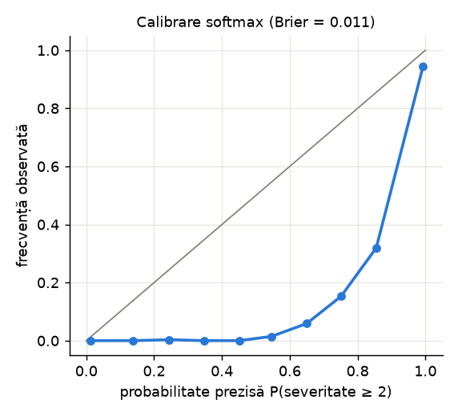

# Rezultatele evaluării ML1 (generat automat)

Generat de `python -m ml1.evaluate` (seed 0, 78.3 s). Protocolul și limitele sunt în [EVALUATION.md](EVALUATION.md). **Datele sunt simulate**: cifrele compară variante între ele, nu prezic performanța pe șoferi reali.

Șoferi: {'train': 20, 'val': 8, 'test': 10, 'shift': 8} · cadre: {'train': 57714, 'val': 24241, 'test': 29962, 'shift': 23542} · 5 Hz

## Test (șoferi standard, nevăzuți)

| Variantă | macro-F1 [IC 95%] | recall severitate 3 [IC 95%] | cost / cadru ↓ | alarme false / oră ↓ | latență urgență (s, mediană) | 112 corecte · false |
|---|---|---|---|---|---|---|
| clasa majoritară (0) | 0.241 [0.24–0.24] | 0.00 [0.00–0.00] | 1.215 | – | – | – |
| prag pe a | 0.357 [0.32–0.39] | 0.68 [0.53–0.96] | 0.259 | – | – | – |
| softmax | 0.835 [0.77–0.88] | 1.00 [1.00–1.00] | 0.055 | – | – | – |
| arbore | 0.687 [0.61–0.76] | 0.93 [0.78–1.00] | 0.151 | – | – | – |
| reguli, praguri vechi (legacy) | 0.741 [0.66–0.81] | 0.96 [0.94–0.99] | 0.147 | 20.1 | 3.0 | 7/7 · fals 0 |
| rules fără calibrare | 0.819 [0.73–0.89] | 0.96 [0.94–0.99] | 0.105 | 16.6 | 3.0 | 7/7 · fals 0 |
| HMM (cea mai probabilă stare) | 0.966 [0.92–0.99] | 0.99 [0.98–0.99] | 0.039 | – | – | – |
| HMM vechi (pe cadru, prag pe încredere, fără 0+) | 0.881 [0.77–0.93] | 0.76 [0.43–0.97] | 0.272 | – | – | – |
| HMM (cost așteptat minim) | 0.946 [0.89–0.97] | 1.00 [1.00–1.00] | 0.037 | – | – | – |
| rules ∨ HMM Bayes | 0.839 [0.76–0.89] | 1.00 [1.00–1.00] | 0.076 | – | – | – |
| rules+calibrare | 0.849 [0.77–0.90] | 0.96 [0.94–1.00] | 0.099 | 14.5 | 3.0 | 7/7 · fals 0 |

Recall pe clasă (rules+calibrare): 0 OK: 0.97, 1 Redusă: 1.00, 2 Medie: 0.91, 3 Ridicată: 0.96

Precizie pe clasă (rules+calibrare): 0 OK: 1.00, 1 Redusă: 0.78, 2 Medie: 0.43, 3 Ridicată: 0.94

Latența de detecție (rules+calibrare): severitate 1: mediană 0.0 s, p90 0.0 s, ratate 0/30; severitate 2: mediană 3.9 s, p90 9.7 s, ratate 0/10; severitate 3: mediană 3.0 s, p90 6.0 s, ratate 0/7

## Shift (ochi mici, zgomot, fața pierdută des)

| Variantă | macro-F1 [IC 95%] | recall severitate 3 [IC 95%] | cost / cadru ↓ | alarme false / oră ↓ | latență urgență (s, mediană) | 112 corecte · false |
|---|---|---|---|---|---|---|
| clasa majoritară (0) | 0.241 [0.24–0.24] | 0.00 [0.00–0.00] | 1.101 | – | – | – |
| prag pe a | 0.332 [0.29–0.36] | 0.83 [0.59–1.00] | 0.290 | – | – | – |
| softmax | 0.652 [0.58–0.78] | 0.99 [0.98–1.00] | 0.271 | – | – | – |
| arbore | 0.480 [0.42–0.55] | 0.83 [0.68–1.00] | 0.409 | – | – | – |
| reguli, praguri vechi (legacy) | 0.743 [0.67–0.84] | 0.98 [0.95–1.00] | 0.152 | 21.0 | 3.0 | 5/5 · fals 0 |
| rules fără calibrare | 0.561 [0.50–0.62] | 0.98 [0.96–1.00] | 0.485 | 56.0 | 3.0 | 5/5 · fals 0 |
| HMM (cea mai probabilă stare) | 0.958 [0.93–0.98] | 0.99 [0.97–1.00] | 0.053 | – | – | – |
| HMM vechi (pe cadru, prag pe încredere, fără 0+) | 0.849 [0.77–0.90] | 0.81 [0.40–1.00] | 0.224 | – | – | – |
| HMM (cost așteptat minim) | 0.944 [0.90–0.97] | 1.00 [1.00–1.00] | 0.049 | – | – | – |
| rules ∨ HMM Bayes | 0.816 [0.74–0.90] | 1.00 [1.00–1.00] | 0.115 | – | – | – |
| rules+calibrare | 0.825 [0.75–0.90] | 0.98 [0.95–1.00] | 0.122 | 14.0 | 3.0 | 5/5 · fals 0 |

Recall pe clasă (rules+calibrare): 0 OK: 0.95, 1 Redusă: 1.00, 2 Medie: 0.79, 3 Ridicată: 0.98

Precizie pe clasă (rules+calibrare): 0 OK: 1.00, 1 Redusă: 0.83, 2 Medie: 0.38, 3 Ridicată: 0.84

Latența de detecție (rules+calibrare): severitate 1: mediană 0.0 s, p90 0.3 s, ratate 0/24; severitate 2: mediană 5.1 s, p90 10.1 s, ratate 0/8; severitate 3: mediană 3.0 s, p90 4.8 s, ratate 0/5

## Alegerea profilului de praguri (pe validare)

| Profil | macro-F1 | cost / cadru | alarme false / oră | 112 corecte · ratate · false |
|---|---|---|---|---|
| legacy | 0.761 | 0.120 | 12.9 | 7 · 0 · 0 |
| cv | 0.835 | 0.079 | 8.6 | 7 · 0 · 0 |
| cv_signs **(ales)** | 0.832 | 0.078 | 10.3 | 7 · 0 · 0 |

Praguri pe scorul a alese pe validare (cost minim): (0.8, 0.75, 0.7) (sub primul = 1, sub al doilea = 2, sub al treilea = 3).

Scorul 1 − a ca detector pentru severitate ≥ 2 (test): ROC-AUC 0.990, AP 0.862. Calibrarea softmax: Brier 0.011.

## Arborele de decizie învățat (reguli citibile)

```
dacă a_raw <= 0.945:
    dacă blink <= 11.3:
        dacă ear_ratio <= 0.943:
            dacă perclos <= 0.0418:
                -> severitate 2  (n=81, distribuție [0.081, 0.09, 0.73, 0.099])
            altfel (perclos > 0.0418):
                -> severitate 2  (n=1536, distribuție [0.002, 0.003, 0.994, 0.001])
        altfel (ear_ratio > 0.943):
            dacă a <= 0.61:
                -> severitate 2  (n=72, distribuție [0.03, 0.0, 0.871, 0.099])
            altfel (a > 0.61):
                -> severitate 1  (n=214, distribuție [0.035, 0.596, 0.04, 0.329])
    altfel (blink > 11.3):
        dacă dur_phone_in_hand <= 0:
            dacă a_raw <= 0.778:
                -> severitate 3  (n=2308, distribuție [0.018, 0.0, 0.091, 0.891])
            altfel (a_raw > 0.778):
                -> severitate 1  (n=2813, distribuție [0.138, 0.85, 0.011, 0.0])
        altfel (dur_phone_in_hand > 0):
            -> severitate 1  (n=422, distribuție [0.0, 1.0, 0.0, 0.0])
altfel (a_raw > 0.945):
    dacă ear_ratio <= 0.933:
        dacă blink <= 12.6:
            dacă a_raw <= 0.993:
                -> severitate 2  (n=67, distribuție [0.06, 0.0, 0.94, 0.0])
            altfel (a_raw > 0.993):
                -> severitate 2  (n=147, distribuție [0.472, 0.0, 0.528, 0.0])
        altfel (blink > 12.6):
            -> severitate 0  (n=1905, distribuție [1.0, 0.0, 0.0, 0.0])
    altfel (ear_ratio > 0.933):
        dacă blink <= 10.8:
            dacă a_raw <= 0.985:
                -> severitate 0  (n=219, distribuție [0.733, 0.0, 0.267, 0.0])
            altfel (a_raw > 0.985):
                -> severitate 0  (n=1879, distribuție [0.986, 0.0, 0.014, 0.0])
        altfel (blink > 10.8):
            dacă a <= 0.852:
                -> severitate 0  (n=1879, distribuție [0.986, 0.0, 0.014, 0.0])
            altfel (a > 0.852):
                -> severitate 0  (n=35701, distribuție [1.0, 0.0, 0.0, 0.0])
```

## Matricea de probabilitate (filtru Bayes / HMM, `ml1/probability.py`)

Învățată doar pe train (20 călătorii, 55101 cadre, 0.104 s). Stări = severitatea reală; observația = (severitatea din reguli, treapta lui a). Durata medie în stare: atent 106 s, distras 6 s, obosit 30 s, urgență 208 s.

Tranziția pe 1 s, P(S(t+1) = coloană | S(t) = rând):

| | atent | distras | obosit | urgență |
|---|---|---|---|---|
| atent | 0.9910 | 0.0055 | 0.0020 | 0.0015 |
| distras | 0.1546 | 0.8427 | 0.0014 | 0.0014 |
| obosit | 0.0311 | 0.0008 | 0.9674 | 0.0008 |
| urgență | 0.0017 | 0.0015 | 0.0016 | 0.9952 |

Observații independente pe secundă (`evidence_hz`), alese pe validare după log-loss: **1.0**. Log-loss pe validare: 0.5 → 0.1888, 1.0 → 0.1811, 2.0 → 0.2063, 3.0 → 0.2372, 5.0 → 0.2927.

### Statistici pe matricea de confuzie — test

P(starea reală | severitatea publicată) = cât de credibilă e fiecare alarmă (rules+calibrare):

| | atent | distras | obosit | urgență |
|---|---|---|---|---|
| publicat 0 | 0.998 | 0.000 | 0.001 | 0.001 |
| publicat 1 | 0.223 | 0.777 | 0.000 | 0.000 |
| publicat 2 | 0.567 | 0.000 | 0.433 | 0.000 |
| publicat 3 | 0.024 | 0.000 | 0.037 | 0.939 |

| Stare | suport | sensibilitate | specificitate | VPP | VPN | LR+ | LR− |
|---|---|---|---|---|---|---|---|
| atent | 23619 | 0.968 | 0.973 | 0.998 | 0.690 | 35.4 | 0.033 |
| distras | 418 | 1.000 | 0.995 | 0.777 | 1.000 | 207.6 | 0.000 |
| obosit | 513 | 0.908 | 0.975 | 0.433 | 0.998 | 37.0 | 0.094 |
| urgență | 785 | 0.962 | 0.998 | 0.939 | 0.999 | 481.9 | 0.038 |

| Variantă | acuratețe | acuratețe echilibrată | kappa | MCC | cost / cadru ↓ |
|---|---|---|---|---|---|
| rules+calibrare | 0.967 | 0.960 | 0.789 | 0.803 | 0.099 |
| HMM (cost așteptat minim) | 0.989 | 0.980 | 0.922 | 0.924 | 0.037 |

Costul filtrului: 5.6 µs / cadru (Python pur).

Aceleași date la 10 Hz (ca `merge.py` cu două laptopuri) față de 5 Hz: abaterea maximă a lui P(stare) și costul pe cadru la 10 Hz.

| Filtru | max abatere P(stare) ↓ | cost / cadru la 10 Hz ↓ |
|---|---|---|
| nou (evidență pe secundă + acoperire) | 0.024 | 0.036 |
| vechi (evidență pe cadru) | 0.880 | 0.268 |

### Statistici pe matricea de confuzie — shift

P(starea reală | severitatea publicată) = cât de credibilă e fiecare alarmă (rules+calibrare):

| | atent | distras | obosit | urgență |
|---|---|---|---|---|
| publicat 0 | 0.997 | 0.000 | 0.002 | 0.001 |
| publicat 1 | 0.166 | 0.834 | 0.000 | 0.000 |
| publicat 2 | 0.621 | 0.000 | 0.379 | 0.000 |
| publicat 3 | 0.000 | 0.000 | 0.164 | 0.836 |

| Stare | suport | sensibilitate | specificitate | VPP | VPN | LR+ | LR− |
|---|---|---|---|---|---|---|---|
| atent | 18655 | 0.953 | 0.966 | 0.997 | 0.612 | 27.8 | 0.048 |
| distras | 331 | 1.000 | 0.997 | 0.834 | 1.000 | 299.3 | 0.000 |
| obosit | 621 | 0.791 | 0.959 | 0.379 | 0.993 | 19.1 | 0.218 |
| urgență | 475 | 0.979 | 0.995 | 0.836 | 0.999 | 210.9 | 0.021 |

| Variantă | acuratețe | acuratețe echilibrată | kappa | MCC | cost / cadru ↓ |
|---|---|---|---|---|---|
| rules+calibrare | 0.950 | 0.931 | 0.707 | 0.729 | 0.122 |
| HMM (cost așteptat minim) | 0.987 | 0.976 | 0.910 | 0.911 | 0.049 |

Costul filtrului: 3.7 µs / cadru (Python pur).

Aceleași date la 10 Hz (ca `merge.py` cu două laptopuri) față de 5 Hz: abaterea maximă a lui P(stare) și costul pe cadru la 10 Hz.

| Filtru | max abatere P(stare) ↓ | cost / cadru la 10 Hz ↓ |
|---|---|---|
| nou (evidență pe secundă + acoperire) | 0.024 | 0.049 |
| vechi (evidență pe cadru) | 0.877 | 0.232 |

## Situațiile noi din Vision (postură, două laptopuri, respirația oprită)

Pe segment: severitatea țintă atinsă și latența de la debut; pentru urgențe și dacă P(urgență) ≥ 0.5 (confirmarea MRM a ECU-ului) cu filtrul nou / vechi; pentru un laptop căzut (șofer atent), în câte segmente ML1 a dat o alarmă falsă, cu și fără câmpul `cameras` din merge.py (fără el, laptopul feței căzut arăta ca „șoferul nu privește drumul”).

| Split | Situație | țintă | n | detectat | latență (s) | P(urgență) ≥ 0.5 nou · vechi (latență s) | alarme false ↓ (fără `cameras`) |
|---|---|---|---|---|---|---|---|
| test | aplecat / cocoșat (bad_posture) | 1 | 10 | 10/10 | 0.0 | – | – |
| test | căzut într-o parte (slumped_side), doar camera corpului | 3 | 2 | 2/2 | 2.0 | 2/2 · 0/2 (3.6 · –) | – |
| test | ieșit din poziție (out_of_position) | 1 | 10 | 10/10 | 0.0 | – | – |
| test | laptopul corpului nu trimite (8–40 s) | 0 | 10 | – | – | – | 0/10 (0/10) |
| test | laptopul feței nu trimite (8–40 s) | 0 | 10 | – | – | – | 0/10 (7/10) |
| test | mână pe piept, respirație măsurată | 3 | 1 | 1/1 | 3.0 | 1/1 · 1/1 (3.4 · 3.0) | – |
| test | mână pe piept, respirație nemăsurată (implicit în Vision) | 3 | 3 | 3/3 | 6.0 | 3/3 · 3/3 (4.8 · 6.0) | – |
| test | prăbușit în față (head_on_wheel) | 3 | 1 | 1/1 | 0.6 | 1/1 · 1/1 (1.6 · 0.8) | – |
| shift | aplecat / cocoșat (bad_posture) | 1 | 8 | 8/8 | 0.0 | – | – |
| shift | căzut într-o parte (slumped_side) | 3 | 1 | 1/1 | 2.0 | 1/1 · 1/1 (2.8 · 2.0) | – |
| shift | ieșit din poziție (out_of_position) | 1 | 8 | 8/8 | 0.1 | – | – |
| shift | laptopul corpului nu trimite (8–40 s) | 0 | 8 | – | – | – | 0/8 (0/8) |
| shift | laptopul feței nu trimite (8–40 s) | 0 | 8 | – | – | – | 0/8 (5/8) |
| shift | mână pe piept, respirație măsurată | 3 | 1 | 1/1 | 3.0 | 1/1 · 1/1 (3.4 · 3.0) | – |
| shift | mână pe piept, respirație nemăsurată (implicit în Vision) | 3 | 1 | 1/1 | 6.0 | 1/1 · 1/1 (5.0 · 6.2) | – |
| shift | prăbușit în față (head_on_wheel) | 3 | 1 | 1/1 | 0.6 | 1/1 · 1/1 (1.6 · 0.8) | – |
| shift | prăbușit în față (head_on_wheel), doar camera corpului | 3 | 1 | 1/1 | 3.0 | 1/1 · 0/1 (4.0 · –) | – |
| urgențe dedicate | căzut într-o parte (slumped_side) | 3 | 10 | 10/10 | 2.0 | 10/10 · 10/10 (2.8 · 2.0) | – |
| urgențe dedicate | căzut într-o parte (slumped_side), doar camera corpului | 3 | 10 | 10/10 | 2.0 | 10/10 · 0/10 (3.6 · –) | – |
| urgențe dedicate | mână pe piept, respirație măsurată | 3 | 7 | 7/7 | 3.0 | 7/7 · 7/7 (3.4 · 3.0) | – |
| urgențe dedicate | mână pe piept, respirație nemăsurată (implicit în Vision) | 3 | 3 | 3/3 | 6.0 | 3/3 · 3/3 (4.8 · 6.0) | – |
| urgențe dedicate | prăbușit în față (head_on_wheel) | 3 | 10 | 10/10 | 0.6 | 10/10 · 10/10 (1.6 · 0.8) | – |
| urgențe dedicate | prăbușit în față (head_on_wheel), doar camera corpului | 3 | 10 | 10/10 | 3.0 | 10/10 · 2/10 (4.0 · 3.0) | – |

## Controlul fuzzy pentru ECU (`ml1/ecu_fuzzy.py`)

Intrări: a, riscul 0.5·P(obosit) + P(urgență) din matricea de probabilitate, încrederea; supervizor determinist deasupra (plafoane pe severitate, MRM, rată limitată). Viteza setată: 100 km/h.

| Split | viteză medie: atent · distras · obosit · urgență | timp normal încetinit < 90% ↓ (din care ≥ 15 s după un episod) | fără ochi încetinit (cameră oprită, laptopul feței căzut) | MRM atins | întârziere MRM (s, mediană) | călătorii cu MRM fals ↓ | viteză la 30 s după urgență | µs / pas |
|---|---|---|---|---|---|---|---|---|
| test | 97% · 92% · 65% · 24% | 6.3% (2.5%) | 71% | 7/7 | 11.0 | 0 | 0 km/h | 57 |
| shift | 97% · 92% · 66% · 24% | 6.5% (2.7%) | 65% | 5/5 | 10.0 | 0 | 0 km/h | 59 |
| urgențe dedicate | 99% · – · – · 26% | 0.8% (0.8%) | –% | 50/50 | 10.0 | 0 | – km/h | 58 |
| test, filtrul vechi | 97% · 92% · 65% · 26% | 7.3% (3.4%) | 71% | 7/7 | 11.0 | 0 | 0 km/h | 60 |
| shift, filtrul vechi | 97% · 92% · 66% · 25% | 8.1% (4.4%) | 65% | 5/5 | 10.0 | 0 | 0 km/h | 58 |
| urgențe dedicate, filtrul vechi | 99% · – · – · 27% | 1.8% (1.8%) | –% | 50/50 | 10.0 | 0 | – km/h | 59 |





