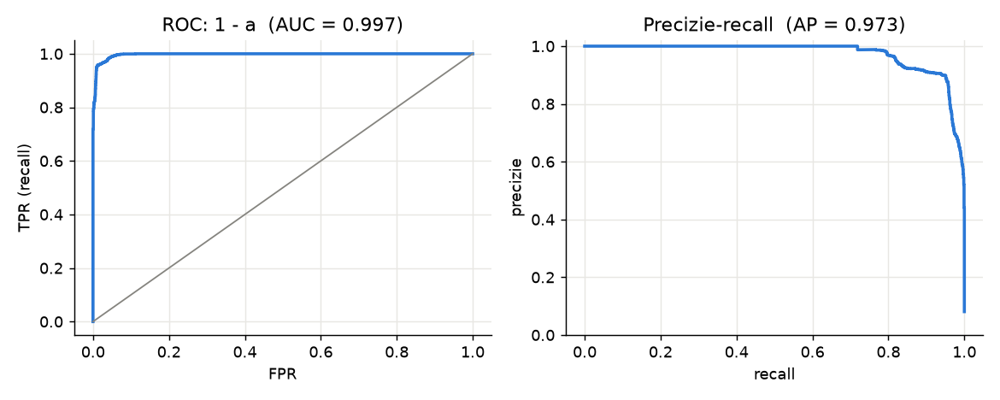

# Rezultatele evaluării ML1 (generat automat)

Generat de `python -m ml1.evaluate` (seed 0, 188.5 s). Protocolul și limitele sunt în [EVALUATION.md](EVALUATION.md). **Datele sunt simulate**: cifrele compară variante între ele, nu prezic performanța pe șoferi reali.

Șoferi: {'train': 20, 'val': 8, 'test': 10, 'shift': 8} · cadre: {'train': 38039, 'val': 15078, 'test': 18930, 'shift': 15330} · 5 Hz

## Test (șoferi standard, nevăzuți)

| Variantă | macro-F1 [IC 95%] | recall severitate 3 [IC 95%] | cost / cadru ↓ | alarme false / oră ↓ | latență urgență (s, mediană) | 112 corecte · false |
|---|---|---|---|---|---|---|
| clasa majoritară (0) | 0.238 [0.24–0.24] | 0.00 [0.00–0.00] | 1.563 | – | – | – |
| prag pe a | 0.388 [0.33–0.43] | 1.00 [1.00–1.00] | 0.135 | – | – | – |
| softmax | 0.953 [0.89–0.99] | 1.00 [0.99–1.00] | 0.041 | – | – | – |
| arbore | 0.916 [0.85–0.96] | 0.97 [0.94–1.00] | 0.074 | – | – | – |
| reguli, praguri vechi (legacy) | 0.753 [0.64–0.85] | 1.00 [1.00–1.00] | 0.171 | 18.2 | 0.6 | 6/6 · fals 0 |
| rules fără calibrare | 0.816 [0.76–0.88] | 1.00 [1.00–1.00] | 0.093 | 14.8 | 0.6 | 6/6 · fals 0 |
| rules+calibrare | 0.825 [0.76–0.87] | 1.00 [1.00–1.00] | 0.090 | 13.6 | 0.6 | 6/6 · fals 0 |
| LLM+reguli+calibrare | 0.887 [0.82–0.94] | 1.00 [1.00–1.00] | 0.078 | 17.0 | 0.6 | 6/6 · fals 0 |

Recall pe clasă (rules+calibrare): 0 OK: 0.96, 1 Redusă: 1.00, 2 Medie: 0.81, 3 Ridicată: 1.00

Precizie pe clasă (rules+calibrare): 0 OK: 1.00, 1 Redusă: 0.64, 2 Medie: 0.58, 3 Ridicată: 0.77

Latența de detecție (rules+calibrare): severitate 1: mediană 0.0 s, p90 0.0 s, ratate 0/10; severitate 2: mediană 2.3 s, p90 7.9 s, ratate 0/10; severitate 3: mediană 0.6 s, p90 3.0 s, ratate 0/6

## Shift (ochi mici, zgomot, fața pierdută des)

| Variantă | macro-F1 [IC 95%] | recall severitate 3 [IC 95%] | cost / cadru ↓ | alarme false / oră ↓ | latență urgență (s, mediană) | 112 corecte · false |
|---|---|---|---|---|---|---|
| clasa majoritară (0) | 0.235 [0.23–0.24] | 0.00 [0.00–0.00] | 2.035 | – | – | – |
| prag pe a | 0.408 [0.37–0.45] | 1.00 [0.99–1.00] | 0.192 | – | – | – |
| softmax | 0.855 [0.80–0.93] | 1.00 [1.00–1.00] | 0.223 | – | – | – |
| arbore | 0.776 [0.73–0.82] | 0.92 [0.84–0.99] | 0.305 | – | – | – |
| reguli, praguri vechi (legacy) | 0.729 [0.65–0.81] | 1.00 [1.00–1.00] | 0.172 | 21.6 | 0.6 | 7/7 · fals 0 |
| rules fără calibrare | 0.579 [0.50–0.67] | 1.00 [1.00–1.00] | 0.421 | 61.8 | 0.6 | 7/7 · fals 0 |
| rules+calibrare | 0.820 [0.75–0.87] | 1.00 [1.00–1.00] | 0.101 | 20.1 | 0.6 | 7/7 · fals 0 |

Recall pe clasă (rules+calibrare): 0 OK: 0.95, 1 Redusă: 1.00, 2 Medie: 0.83, 3 Ridicată: 1.00

Precizie pe clasă (rules+calibrare): 0 OK: 1.00, 1 Redusă: 0.53, 2 Medie: 0.57, 3 Ridicată: 0.88

Latența de detecție (rules+calibrare): severitate 1: mediană 0.0 s, p90 0.0 s, ratate 0/8; severitate 2: mediană 0.0 s, p90 5.5 s, ratate 0/8; severitate 3: mediană 0.6 s, p90 3.0 s, ratate 0/7

## Alegerea profilului de praguri (pe validare)

| Profil | macro-F1 | cost / cadru | alarme false / oră | 112 corecte · ratate · false |
|---|---|---|---|---|
| legacy | 0.730 | 0.172 | 24.2 | 4 · 0 · 0 |
| cv **(ales)** | 0.810 | 0.116 | 15.6 | 4 · 0 · 0 |
| cv_signs | 0.810 | 0.116 | 15.6 | 4 · 0 · 0 |

Praguri pe scorul a alese pe validare (cost minim): (0.75, 0.7, 0.65) (sub primul = 1, sub al doilea = 2, sub al treilea = 3).

Scorul 1 − a ca detector pentru severitate ≥ 2 (test): ROC-AUC 0.997, AP 0.973. Calibrarea softmax: Brier 0.017.

## Arborele de decizie învățat (reguli citibile)

```
dacă dur_phone_in_hand <= 0:
    dacă a_raw <= 0.891:
        dacă blink <= 13:
            dacă dur_hand_on_chest <= 0:
                -> severitate 2  (n=1761, distribuție [0.012, 0.0, 0.95, 0.038])
            altfel (dur_hand_on_chest > 0):
                -> severitate 3  (n=175, distribuție [0.0, 0.0, 0.0, 1.0])
        altfel (blink > 13):
            dacă a <= 0.653:
                -> severitate 3  (n=1732, distribuție [0.013, 0.0, 0.036, 0.951])
            altfel (a > 0.653):
                -> severitate 0  (n=1132, distribuție [0.921, 0.0, 0.079, 0.0])
    altfel (a_raw > 0.891):
        dacă ear_ratio <= 0.93:
            dacă blink <= 13.5:
                -> severitate 2  (n=286, distribuție [0.143, 0.0, 0.857, 0.0])
            altfel (blink > 13.5):
                -> severitate 0  (n=1082, distribuție [0.983, 0.0, 0.017, 0.0])
        altfel (ear_ratio > 0.93):
            dacă blink <= 10.8:
                -> severitate 0  (n=1372, distribuție [0.887, 0.0, 0.113, 0.0])
            altfel (blink > 10.8):
                -> severitate 0  (n=24450, distribuție [0.997, 0.0, 0.003, 0.0])
altfel (dur_phone_in_hand > 0):
    -> severitate 1  (n=426, distribuție [0.0, 1.0, 0.0, 0.0])
```





