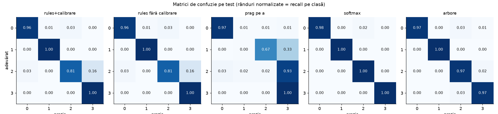
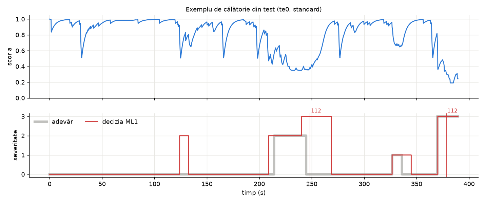

# Rezultatele evaluării ML1 (generat automat)

Generat de `python -m ml1.evaluate` (seed 0, 40.8 s). Protocolul și limitele sunt în [EVALUATION.md](EVALUATION.md). **Datele sunt simulate**: cifrele compară variante între ele, nu prezic performanța pe șoferi reali.

Șoferi: {'train': 20, 'val': 8, 'test': 10, 'shift': 8} · cadre: {'train': 38039, 'val': 15078, 'test': 18930, 'shift': 15330} · 5 Hz

## Test (șoferi standard, nevăzuți)

| Variantă | macro-F1 [IC 95%] | recall severitate 3 [IC 95%] | cost / cadru ↓ | alarme false / oră ↓ | latență urgență (s, mediană) | 112 corecte · false |
|---|---|---|---|---|---|---|
| clasa majoritară (0) | 0.238 [0.24–0.24] | 0.00 [0.00–0.00] | 1.563 | – | – | – |
| prag pe a | 0.388 [0.33–0.43] | 1.00 [1.00–1.00] | 0.135 | – | – | – |
| softmax | 0.953 [0.89–0.99] | 1.00 [0.99–1.00] | 0.041 | – | – | – |
| arbore | 0.916 [0.85–0.96] | 0.97 [0.94–1.00] | 0.074 | – | – | – |
| reguli, praguri vechi (legacy) | 0.753 [0.64–0.85] | 1.00 [1.00–1.00] | 0.171 | 18.2 | 0.6 | 6/6 · fals 0 |
| rules fără calibrare | 0.816 [0.76–0.88] | 1.00 [1.00–1.00] | 0.093 | 14.8 | 0.6 | 6/6 · fals 0 |
| HMM (cea mai probabilă stare) | 0.951 [0.90–0.98] | 1.00 [1.00–1.00] | 0.051 | – | – | – |
| HMM (cost așteptat minim) | 0.941 [0.88–0.98] | 1.00 [1.00–1.00] | 0.057 | – | – | – |
| rules ∨ HMM Bayes | 0.812 [0.75–0.87] | 1.00 [1.00–1.00] | 0.105 | – | – | – |
| rules+calibrare | 0.825 [0.77–0.88] | 1.00 [1.00–1.00] | 0.090 | 13.6 | 0.6 | 6/6 · fals 0 |

Recall pe clasă (rules+calibrare): 0 OK: 0.96, 1 Redusă: 1.00, 2 Medie: 0.81, 3 Ridicată: 1.00

Precizie pe clasă (rules+calibrare): 0 OK: 1.00, 1 Redusă: 0.64, 2 Medie: 0.58, 3 Ridicată: 0.77

Latența de detecție (rules+calibrare): severitate 1: mediană 0.0 s, p90 0.0 s, ratate 0/10; severitate 2: mediană 2.3 s, p90 7.9 s, ratate 0/10; severitate 3: mediană 0.6 s, p90 3.0 s, ratate 0/6

## Shift (ochi mici, zgomot, fața pierdută des)

| Variantă | macro-F1 [IC 95%] | recall severitate 3 [IC 95%] | cost / cadru ↓ | alarme false / oră ↓ | latență urgență (s, mediană) | 112 corecte · false |
|---|---|---|---|---|---|---|
| clasa majoritară (0) | 0.235 [0.23–0.24] | 0.00 [0.00–0.00] | 2.035 | – | – | – |
| prag pe a | 0.408 [0.37–0.45] | 1.00 [0.99–1.00] | 0.192 | – | – | – |
| softmax | 0.855 [0.80–0.96] | 1.00 [1.00–1.00] | 0.223 | – | – | – |
| arbore | 0.776 [0.74–0.82] | 0.92 [0.83–1.00] | 0.305 | – | – | – |
| reguli, praguri vechi (legacy) | 0.729 [0.64–0.81] | 1.00 [1.00–1.00] | 0.172 | 21.6 | 0.6 | 7/7 · fals 0 |
| rules fără calibrare | 0.579 [0.50–0.67] | 1.00 [1.00–1.00] | 0.421 | 61.8 | 0.6 | 7/7 · fals 0 |
| HMM (cea mai probabilă stare) | 0.939 [0.91–0.96] | 1.00 [1.00–1.00] | 0.078 | – | – | – |
| HMM (cost așteptat minim) | 0.927 [0.89–0.95] | 1.00 [1.00–1.00] | 0.088 | – | – | – |
| rules ∨ HMM Bayes | 0.806 [0.74–0.86] | 1.00 [1.00–1.00] | 0.124 | – | – | – |
| rules+calibrare | 0.820 [0.75–0.87] | 1.00 [1.00–1.00] | 0.101 | 20.1 | 0.6 | 7/7 · fals 0 |

Recall pe clasă (rules+calibrare): 0 OK: 0.95, 1 Redusă: 1.00, 2 Medie: 0.83, 3 Ridicată: 1.00

Precizie pe clasă (rules+calibrare): 0 OK: 1.00, 1 Redusă: 0.53, 2 Medie: 0.57, 3 Ridicată: 0.88

Latența de detecție (rules+calibrare): severitate 1: mediană 0.0 s, p90 0.0 s, ratate 0/8; severitate 2: mediană 0.0 s, p90 5.5 s, ratate 0/8; severitate 3: mediană 0.6 s, p90 3.0 s, ratate 0/7

## Alegerea profilului de praguri (pe validare)

| Profil | macro-F1 | cost / cadru | alarme false / oră | 112 corecte · ratate · false |
|---|---|---|---|---|
| legacy | 0.730 | 0.172 | 24.2 | 4 · 0 · 0 |
| cv **(ales)** | 0.810 | 0.116 | 15.6 | 4 · 0 · 0 |
| cv_signs | 0.810 | 0.116 | 15.6 | 4 · 0 · 0 |

Praguri pe scorul a alese pe validare (cost minim): (0.75, 0.7, 0.65) (sub primul = 1, sub al doilea = 2, sub al treilea = 3).

Scorul 1 − a ca detector pentru severitate ≥ 2 (test): ROC-AUC 0.997, AP 0.973. Calibrarea softmax: Brier 0.017.

## Arborele de decizie învățat (reguli citibile)

```
dacă dur_phone_in_hand <= 0:
    dacă a_raw <= 0.891:
        dacă blink <= 13:
            dacă dur_hand_on_chest <= 0:
                -> severitate 2  (n=1761, distribuție [0.012, 0.0, 0.95, 0.038])
            altfel (dur_hand_on_chest > 0):
                -> severitate 3  (n=175, distribuție [0.0, 0.0, 0.0, 1.0])
        altfel (blink > 13):
            dacă a <= 0.653:
                -> severitate 3  (n=1732, distribuție [0.013, 0.0, 0.036, 0.951])
            altfel (a > 0.653):
                -> severitate 0  (n=1132, distribuție [0.921, 0.0, 0.079, 0.0])
    altfel (a_raw > 0.891):
        dacă ear_ratio <= 0.93:
            dacă blink <= 13.5:
                -> severitate 2  (n=286, distribuție [0.143, 0.0, 0.857, 0.0])
            altfel (blink > 13.5):
                -> severitate 0  (n=1082, distribuție [0.983, 0.0, 0.017, 0.0])
        altfel (ear_ratio > 0.93):
            dacă blink <= 10.8:
                -> severitate 0  (n=1372, distribuție [0.887, 0.0, 0.113, 0.0])
            altfel (blink > 10.8):
                -> severitate 0  (n=24450, distribuție [0.997, 0.0, 0.003, 0.0])
altfel (dur_phone_in_hand > 0):
    -> severitate 1  (n=426, distribuție [0.0, 1.0, 0.0, 0.0])
```

## Matricea de probabilitate (filtru Bayes / HMM, `ml1/probability.py`)

Învățată doar pe train (20 călătorii, 35280 cadre, 0.015 s). Stări = severitatea reală; observația = (severitatea din reguli, treapta lui a). Durata medie în stare: atent 112 s, distras 8 s, obosit 30 s, urgență 251 s.

Tranziția pe 1 s, P(S(t+1) = coloană | S(t) = rând):

| | atent | distras | obosit | urgență |
|---|---|---|---|---|
| atent | 0.9913 | 0.0030 | 0.0031 | 0.0026 |
| distras | 0.1164 | 0.8776 | 0.0030 | 0.0030 |
| obosit | 0.0310 | 0.0008 | 0.9674 | 0.0008 |
| urgență | 0.0014 | 0.0013 | 0.0013 | 0.9960 |

### Statistici pe matricea de confuzie — test

P(starea reală | severitatea publicată) = cât de credibilă e fiecare alarmă (rules+calibrare):

| | atent | distras | obosit | urgență |
|---|---|---|---|---|
| publicat 0 | 0.999 | 0.000 | 0.001 | 0.000 |
| publicat 1 | 0.364 | 0.636 | 0.000 | 0.000 |
| publicat 2 | 0.422 | 0.000 | 0.578 | 0.000 |
| publicat 3 | 0.061 | 0.000 | 0.168 | 0.771 |

| Stare | suport | sensibilitate | specificitate | VPP | VPN | LR+ | LR− |
|---|---|---|---|---|---|---|---|
| atent | 14637 | 0.958 | 0.988 | 0.999 | 0.710 | 76.8 | 0.043 |
| distras | 215 | 1.000 | 0.992 | 0.636 | 1.000 | 129.6 | 0.000 |
| obosit | 753 | 0.814 | 0.971 | 0.578 | 0.991 | 28.0 | 0.191 |
| urgență | 555 | 1.000 | 0.989 | 0.771 | 1.000 | 94.6 | 0.000 |

| Variantă | acuratețe | acuratețe echilibrată | kappa | MCC | cost / cadru ↓ |
|---|---|---|---|---|---|
| rules+calibrare | 0.953 | 0.943 | 0.776 | 0.788 | 0.090 |
| HMM (cost așteptat minim) | 0.979 | 0.983 | 0.888 | 0.892 | 0.057 |

Costul filtrului: 3.7 µs / cadru (Python pur).

### Statistici pe matricea de confuzie — shift

P(starea reală | severitatea publicată) = cât de credibilă e fiecare alarmă (rules+calibrare):

| | atent | distras | obosit | urgență |
|---|---|---|---|---|
| publicat 0 | 0.998 | 0.000 | 0.002 | 0.000 |
| publicat 1 | 0.467 | 0.533 | 0.000 | 0.000 |
| publicat 2 | 0.430 | 0.000 | 0.570 | 0.000 |
| publicat 3 | 0.000 | 0.000 | 0.119 | 0.881 |

| Stare | suport | sensibilitate | specificitate | VPP | VPN | LR+ | LR− |
|---|---|---|---|---|---|---|---|
| atent | 11555 | 0.950 | 0.983 | 0.998 | 0.715 | 56.4 | 0.051 |
| distras | 204 | 1.000 | 0.986 | 0.533 | 1.000 | 71.7 | 0.000 |
| obosit | 646 | 0.828 | 0.967 | 0.570 | 0.991 | 25.4 | 0.178 |
| urgență | 635 | 1.000 | 0.993 | 0.881 | 1.000 | 144.2 | 0.000 |

| Variantă | acuratețe | acuratețe echilibrată | kappa | MCC | cost / cadru ↓ |
|---|---|---|---|---|---|
| rules+calibrare | 0.947 | 0.944 | 0.784 | 0.796 | 0.101 |
| HMM (cost așteptat minim) | 0.973 | 0.969 | 0.881 | 0.884 | 0.088 |

Costul filtrului: 3.3 µs / cadru (Python pur).

## Controlul fuzzy pentru ECU (`ml1/ecu_fuzzy.py`)

Intrări: a, riscul 0.5·P(obosit) + P(urgență) din matricea de probabilitate, încrederea; supervizor determinist deasupra (plafoane pe severitate, MRM, rată limitată). Viteza setată: 100 km/h.

| Split | viteză medie: atent · distras · obosit · urgență | timp normal încetinit < 90% ↓ (din care ≥ 15 s după un episod) | cameră oprită încetinit | MRM atins | întârziere MRM (s, mediană) | călătorii cu MRM fals ↓ | viteză la 30 s după urgență | µs / pas |
|---|---|---|---|---|---|---|---|---|
| test | 97% · 87% · 64% · 20% | 8.6% (2.9%) | 65% | 6/6 | 8.6 | 0 | 0 km/h | 60 |
| shift | 97% · 86% · 63% · 19% | 8.2% (2.1%) | 64% | 7/7 | 8.2 | 0 | 0 km/h | 61 |





